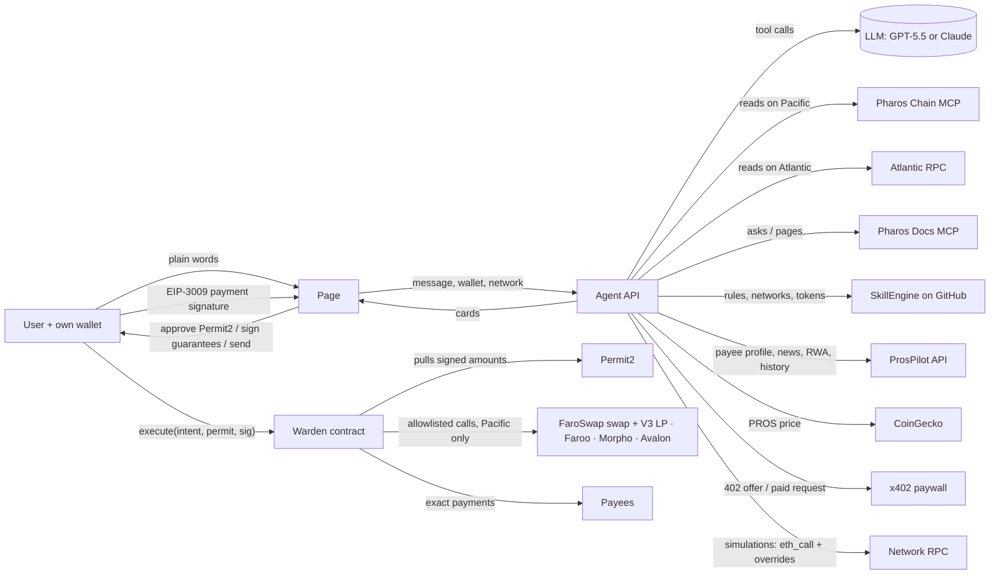

# Architecture

Pharos Warden has three parts: an **agent** that reads Pharos and decides, a **page** where the user talks to it and signs (with four data pages beside it — Trade, Network, Ecosystem, News — each leading back to the agent), and a **contract** that guarantees the outcome. No part holds a user key, and no part holds any key that can move user funds. Everything runs on one of two networks, chosen in the page header: Atlantic Testnet (the default) or Pacific Mainnet.

## 1. The agent (`lib/agent.js`, `lib/agent-openai.js`, `api/agent.js`)

A streamed tool loop on the server. The model is GPT-5.5 (OpenAI) or Claude Opus 5.5 (Anthropic), whichever key the deployment has. Both loops share the same tools, system prompt and safety rules. Each request runs inside one network (`withNetwork` in `lib/config.js`). The network picks the tools (`toolsFor`), the system prompt (`systemFor`), the tokens and protocols, and where chain reads come from: the **Chain MCP** on Pacific, the public RPC on Atlantic (the Chain MCP serves Pacific only).

| Tool | Source | What for | Networks |
|---|---|---|---|
| `wallet_overview` | Chain MCP / RPC | balances, vault positions in USDC, Permit2 approvals, the Warden policy and what is left today | both |
| `check_payee` | Chain MCP / RPC (`get_code`, `get_transaction_count`, `get_logs`, `eth_call`) + **ProsPilot** | contract or wallet, never used, USDC-blacklisted, token/protocol contract, look-alike of a recent counterparty, broken checksum; ProsPilot's wallet profile as a second opinion on Pacific | both |
| `check_transaction` | RPC `eth_call` with **SimProbe** as the user's code | any dApp's transaction run as the user: balance and allowance changes, would it fail, risk flags, verdict | both |
| `check_signature` | decoding + `get_code` of the spender | Permit, Permit2, EIP-3009, Seaport, Warden intents; drainer patterns | both |
| `scan_approvals` / `propose_revoke` | `get_logs` (Approval events of the owner, any token) + `eth_call` allowances | live ERC-20 and Permit2 allowances with their risk; the revoke transaction the user signs | both |
| `explain_tx` | `get_transaction`, `get_transaction_receipt`, `eth_call` replay | any transaction in words, why it failed | both |
| `verify_tokens` | **Docs MCP** (`getPage` token registry) + **SkillEngine** `tokens.json` + chain | the network's token addresses from three sources; disagreements reported | both |
| `docs_ask` | **Docs MCP** (`askQuestion`) | any Pharos fact the decision depends on, with sources | both |
| `skill_engine` | **SkillEngine** `SKILL.md`, `networks.json` | its write-operation rules and the network's config | both |
| `propose_payment` | deterministic builder + dry run | 1–10 exact payments in one signature | both |
| `propose_policy` / `_policy_change` | deterministic builders | a policy transaction the user signs | both |
| `verify_execution` | receipt | the receipt, decoded against what was signed | both |
| `propose_approve` / `check_allowance` | `get_code` + `eth_call` | an exact approval (never to a plain wallet); ERC-20 and Permit2 allowances | both |
| `propose_send_native` | payee check | a plain PROS / PHRS transfer the user signs | both |
| `check_link` | static analysis (never fetches) | official domain or look-alike (edit distance, homoglyphs, punycode), "@", free hosting, drainer paths | both |
| `wallet_score` | the reads above | a 0–100 score, every part with on-chain evidence | both |
| `buy_data` | **x402** paywall + `@x402` client | premium data paid per call by the user's EIP-3009 signature (see 4) | both |
| `pharos_news` / `rwa_market` / `web3_briefing` / `ecosystem` | ProsPilot's API; the official Pharos Port list | news, campaigns, RWA figures, briefings, the 43-project directory | both |
| `pool_info` | Chain MCP `eth_call` (`slot0`, `liquidity`) | the four FaroSwap V3 WPROS/USDC pools | Pacific |
| `propose_add_liquidity` | builder + **two** dry runs | the mint dry-run with zero minimums, then the minimums set from what it used, minus the slippage | Pacific |
| `lp_positions` / `propose_remove_liquidity` | NPM reads + `eth_call` of `decreaseLiquidity` / `collect` as the owner | exact amounts and uncollected fees; a remove whose minimums come from the same simulation | Pacific |
| `staking_info` / `propose_stake` / `propose_unstake` | stPROS share price now and 7 days back; builder + dry run | realised yield; a guarded stake (wrap step if needed); the 7-day unstake request | Pacific |
| `realfi_positions` / `tx_history` | the verified RealFi registry; ProsPilot's indexer API | RWA / RealFi holdings valued in their asset; recent transactions | Pacific |
| `vault_rates` | Chain MCP (`get_block`, `eth_call` at a block 7 days back) | realised 7-day APY from share prices / income index, and size | Pacific |
| `quote_swap` | RPC `eth_call` with state overrides + CoinGecko | the exact FaroSwap output, price impact, pool price vs market | Pacific |
| `propose_swap` / `_deposit` / `_withdraw` | deterministic builders + dry run | an intent card the user signs | Pacific |

The model decides which tools to call, what to recommend, and what to propose (venue, amount, slippage, limits, payees). It never writes calldata, chooses addresses, computes guarantees or touches a key. Every tool input is validated against its JSON schema before it runs (`validateInput`), and a tool from the other network is refused.

The conversation is sent back to the page **sealed** (HMAC, `lib/session.js`) and tagged with its provider and network, so a page cannot forge tool results, rewrite what the agent said, or replay a conversation on the other network. Visitors are rate-limited per IP. Reads against public endpoints run a few at a time (`lib/pool.js`), because the endpoints throttle bursts.

## 2. The intent and the dry run (`lib/intent.js`, `lib/simulate.js`)

An intent is made of:
- exact approvals to allowlisted spenders, and allowlisted calls;
- **outs**: the user's balance of a token must grow by at least `minDelta`;
- **pays**: exact payments;
- a deadline and a plan id.

The user's inputs are a Permit2 batch: exact tokens and amounts, and a one-time nonce. A batch payment is one intent with several `pays` and one input, the total.

Before anything is signed, the exact `Warden.execute` transaction is dry-run with one `eth_call` against live state:

- Permit2's code is replaced by `SimPermit2`, which moves the permitted tokens without checking a signature (there is none yet).
- The **user's own address** gets `SimRunner` code, which calls `Warden.execute` as the user and reads their balances around it.
- Steps the user has not taken yet (the Permit2 approval, the policy) are overridden in storage and **listed on the card as assumptions**.

The card shows what the user would receive, the gas, the network fee and any refusal in plain words (`explainRevert`). On a fork, the real result matched the dry run for every intent kind (`test/fork-e2e.js`). On Atlantic, a real batch payment matched it too (README, *Proof on Atlantic*).

## 3. Checking other dApps (`lib/guard.js`)

`check_transaction` uses the same trick for transactions Warden did not build. `SimProbe` becomes the user's code; it records the native and token balances and the allowances, calls the target with the dApp's calldata and value as the user, and records them again. Watched tokens are the network's known tokens, the target itself if it is a token, and any token among the call's address arguments. Watched allowances are those of the target and of an `approve`'s spender. On top of the simulation come decoded-call flags: an approval to a plain wallet, an unlimited approval to an unknown contract, giving without receiving, a call that would fail, an unknown selector. These are ProsPilot's pre-sign rules, now resting on what the simulation saw.

`check_signature` covers what no simulator sees: off-chain signatures that move funds later. `scan_approvals` reads allowances live and labels each spender from the network's known contracts and its code. `explain_tx` decodes logs against Warden's, Permit2's and the common token ABIs, and replays a failed transaction on the previous block for its revert reason.

## 4. x402: paid data, paid by the user (`lib/x402.js`, `api/x402.js`)

The agent can buy premium data from a Pharos x402 paywall (pay per call, Circle USDC on Atlantic). No key signs on the server:

1. **prepare**: the server requests the resource, gets the 402 and its offer, and checks it: our catalog's host and path only, eip155:688689, Circle USDC, at most 0.01 USDC, and `payTo` equal to the paywall's published catalog. Then the official `@x402` client builds the payment with a *recording* signer, which captures the EIP-712 typed data (an EIP-3009 `TransferWithAuthorization`) instead of signing it.
2. **sign**: the card shows price and payee; the user's wallet signs that typed data.
3. **settle**: the server re-checks that the signed authorization is the prepared one, the signer recovers to the connected wallet, and the cap still holds. It puts the signature into the same payment, sends the paid request, and returns the data and the settlement transaction.

## 5. The pages (`public/trade.html`, `network.html`, `ecosystem.html`, `news.html`, `public/js/site.js`)

The four pages show public data, each with its source on the page:
- **Trade:** CoinGecko market data, plus each FaroSwap pool's price read on chain.
- **Network:** RPC health of both networks every 10 s, plus daily charts.
- **Ecosystem:** the official Pharos Port directory.
- **News:** blog, X and Pharos Port campaigns through ProsPilot's API.

Every page links into the agent with the question pre-filled (`/?ask=…&net=…`). Public data is cached a few seconds on the server, so many visitors make one RPC round.

## 6. The contract (`contracts/src/Warden.sol`)

- **No owner, no admin, no upgrade.** The protocol allowlist (call targets and approval spenders) is fixed in the constructor. On Pacific (v2) it holds FaroSwap DODORouteProxy + DODOApprove, Morpho Vault V2 RockawayX and SharpByte, the Avalon pool, Faroo stPROS (stake) and the FaroSwap V3 NonfungiblePositionManager (mint a position to the user). On Atlantic it holds nothing, so that Warden guards payments only.
- **`execute(intent, permit, signature)`** can be called only by `intent.user`. It runs these steps:
  1. user policy: not paused, not expired, every input token has a per-action and per-day limit that the amount fits;
  2. record the user's balances of every `out` token;
  3. `Permit2.permitWitnessTransferFrom` pulls exactly the signed inputs; the witness is the EIP-712 hash of the intent, so changing any guarantee breaks the signature;
  4. exact approvals to allowlisted spenders → allowlisted calls (token-moving selectors, NFT moves — `safeTransferFrom`, `setApprovalForAll` — and `multicall` refused) → approvals back to zero;
  5. exact payments (`payeesOnly` respected);
  6. every leftover goes back to the user;
  7. every `out` checked against the user's real balance; otherwise **the whole transaction reverts**;
  8. events: `Spent`, `Paid`, `Delivered(minDelta, delta)`, `Executed(planId, witness)`.
- **Policy**, per user, set only by that user: `configure`, `setLimit`, `setProtocols`, `setPayee`, `setPayeesOnly`, `setExpiry`, `pause`, `unpause`.

Tests: `contracts/test/Warden.t.sol` runs 31 tests on a fork of Pacific Mainnet, against the real Permit2, USDC, WPROS, FaroSwap (swap and V3 positions), Faroo, Morpho and Avalon, with real Permit2 signatures. `test/fork-e2e.js` runs 12 end-to-end steps on a fork, each real result compared to its dry run.

## Trust model

| If this goes wrong… | …the user still cannot lose more than they signed, because |
|---|---|
| the model misreads a pool or picks a bad venue | the minimum out is computed by code from a live quote and enforced on chain |
| the model or a page is talked into sending funds elsewhere | outs are measured on the user's own balance; pays are exactly as signed |
| a page lowers a minimum after the user signed | the witness changes, so Permit2 rejects the signature |
| someone replays a signed intent | the Permit2 nonce is single-use, and only `intent.user` can call `execute` |
| a protocol call tries to move tokens or NFTs directly | token-moving and NFT-moving selectors and `multicall` are refused, and targets are allowlisted |
| an x402 seller asks for more, or another payee | the server checks the offer against the catalog and a 0.01 USDC cap, and the user signs the exact amount and payee |
| the user over-trusts the agent | their own on-chain limits per action and per day, protocol list, payee list, expiry and pause |
| a check outside Warden misses something | it is advice, shown with its evidence; Warden's guarantees do not depend on it |

What the user does trust: their wallet's display of the typed data (it shows the inputs and the guarantees), the canonical Permit2, and the allowlisted protocols themselves.
