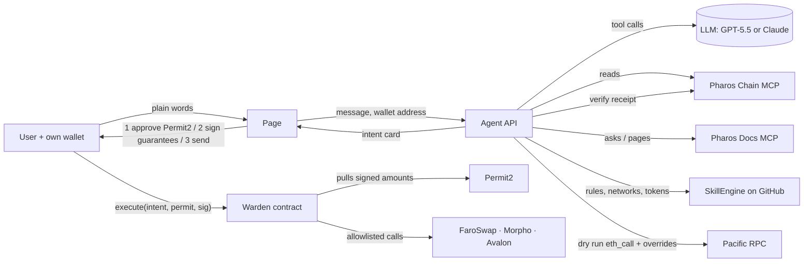

# Architecture

Pharos Warden has three parts: an **agent** that reads Pharos and decides, a **page** where the user talks to it and signs, and a **contract** that guarantees the outcome. No part holds a user key, and no part holds any key that can move user funds.

## 1. The agent (`lib/agent.js`, `lib/agent-openai.js`, `api/agent.js`)

A streamed tool loop on the server. The model is GPT-5.5 (OpenAI) or Claude Opus 5.5 (Anthropic), whichever key the deployment has; both loops share the same 14 tools, system prompt and safety rules.

| Tool | Source | What for |
|---|---|---|
| `wallet_overview` | **Chain MCP** (`get_balance`, `eth_call`) | balances, vault positions in USDC, Permit2 approvals, the user's Warden policy and what is left today |
| `vault_rates` | **Chain MCP** (`get_block`, `eth_call` at a block 7 days back) | realised 7-day APY from share prices / income index, and size |
| `check_payee` | **Chain MCP** (`get_code`, `get_transaction_count`, `get_logs`, `eth_call`) | contract or wallet, never used, USDC-blacklisted, a token/protocol contract, a look-alike of a recent counterparty (address poisoning), a broken checksum |
| `verify_tokens` | **Docs MCP** (`getPage` token registry) + **SkillEngine** `tokens.json` + **Chain MCP** | the same USDC/WPROS addresses from three independent sources |
| `docs_ask` | **Docs MCP** (`askQuestion`) | any Pharos fact the decision depends on, with sources |
| `skill_engine` | **SkillEngine** `SKILL.md`, `networks.json` | its write-operation rules (mainnet warning, key hygiene) and network config |
| `quote_swap` | Pacific RPC `eth_call` with state overrides | the exact FaroSwap output (the Chain MCP's `eth_call` takes no overrides) |
| `propose_swap` / `_deposit` / `_withdraw` / `_payment` | deterministic builders + dry run | an intent card the user signs |
| `propose_policy` / `_policy_change` | deterministic builders | a policy transaction the user signs |
| `verify_execution` | **Chain MCP** (`get_transaction_receipt`) | the receipt, decoded against what was signed |

What the model decides: which tools to call, what to recommend, and what to propose (venue, amount, slippage, limits). What it never does: write calldata, choose addresses, compute guarantees or touch a key. Every tool input is validated against its JSON schema before it runs (`validateInput`).

The conversation is sent back to the page **sealed** (HMAC, `lib/session.js`) so a page cannot forge tool results or rewrite what the agent said. Visitors are rate-limited per IP.

## 2. The intent and the dry run (`lib/intent.js`, `lib/simulate.js`)

An intent is: exact approvals to allowlisted spenders, allowlisted calls, **outs** (the user's balance of a token must grow by at least `minDelta`), **pays** (exact payments), a deadline and a plan id. The user's inputs are a Permit2 batch: exact tokens and amounts, a one-time nonce.

Before anything is signed, the exact `Warden.execute` transaction is dry-run with one `eth_call` against live Pacific state:

- Permit2's code is replaced by `SimPermit2` (moves the permitted tokens without checking a signature — there is none yet);
- the **user's own address** gets `SimRunner` code, which calls `Warden.execute` as the user and reads their balances around it;
- steps the user has not taken yet (the Permit2 approval, the policy) are overridden in storage and **listed on the card as assumptions**.

The card shows what the user would receive, the gas, and any refusal in plain words (`explainRevert`). On a fork, the real result matched the dry run for every intent kind (`test/fork-e2e.js`).

## 3. The contract (`contracts/src/Warden.sol`)

- **No owner, no admin, no upgrade.** The protocol allowlist (call targets and approval spenders) is fixed in the constructor: FaroSwap DODORouteProxy + DODOApprove, Morpho Vault V2 RockawayX and SharpByte, Avalon pool.
- **`execute(intent, permit, signature)`**, only by `intent.user`:
  1. user policy: not paused, not expired, every input token has a per-action and per-day limit that the amount fits;
  2. record the user's balances of every `out` token;
  3. `Permit2.permitWitnessTransferFrom` pulls exactly the signed inputs; the witness is the EIP-712 hash of the intent, so changing any guarantee breaks the signature;
  4. exact approvals to allowlisted spenders → allowlisted calls (token-moving selectors refused) → approvals back to zero;
  5. exact payments (`payeesOnly` respected);
  6. every leftover goes back to the user;
  7. every `out` checked against the user's real balance — otherwise **the whole transaction reverts**;
  8. events: `Spent`, `Paid`, `Delivered(minDelta, delta)`, `Executed(planId, witness)`.
- **Policy**, per user, set only by that user: `configure`, `setLimit`, `setProtocols`, `setPayee`, `setPayeesOnly`, `setExpiry`, `pause`, `unpause`.

Tests: `contracts/test/Warden.t.sol`, 28 tests on a fork of Pacific Mainnet against the real Permit2, USDC, WPROS, FaroSwap, Morpho and Avalon, with real Permit2 signatures.

## Trust model

| If this goes wrong… | …the user still cannot lose more than they signed, because |
|---|---|
| the model misreads a pool or picks a bad venue | the minimum out is computed by code from a live quote and enforced on chain |
| the model or a page is talked into sending funds elsewhere | outs are measured on the user's own balance; pays are exactly as signed |
| a page lowers a minimum after the user signed | the witness changes: Permit2 rejects the signature |
| someone replays a signed intent | Permit2 nonce is single-use; only `intent.user` can call `execute` |
| a protocol call tries to move tokens directly | token-moving selectors are refused; targets are allowlisted |
| the user over-trusts the agent | their own on-chain limits per action / per day, protocol list, payee list, expiry and pause |

What the user does trust: their wallet's display of the typed data (it shows the inputs and the guarantees), the canonical Permit2, and the allowlisted protocols themselves.
